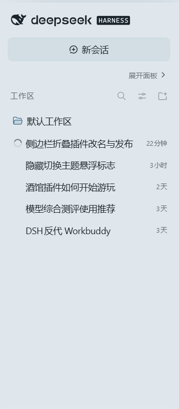

# dsh-sidebar-panel-collapse

Adds a collapse toggle above the DSH sidebar panel list. One click hides the whole
panel block (MUV 表格 / 插件 / 插件市场 / 技能 / 归档会话 / 自动化任务 / 上下文洞察 /
记忆系统 / 更多) so the workspace list below it gets the vertical space.

Nothing else changes: the sidebar itself stays, the collapse state is remembered
per browser, and the workspace area simply grows from one row-height section up.

## What it looks like

Expanded — the toggle sits right under 「新会话」, above 「MUV 表格」:


Collapsed — every panel entry row is gone and 工作区 fills the height:



## Install

```sh
dsh plugin --profile web add dsh-sidebar-panel-collapse
```

Or from a checkout of this repository:

```sh
dsh plugin --profile web add github:OWNER/dsh-sidebar-panel-collapse
```

Restart DeepSeek Harness once after installing so the bundle row is composed into
the profile. In the plugin market card you can toggle it off/on at any time.

## How it works

The browser half (`lib/client.js`) registers one client bundle:

1. Injects a single `<style>` element keyed `dsh-sidebar-panel-collapse/toggle.css`.
   All hiding rules key on `html[data-dsh-sidebar-panel-collapsed="1"]`, so the state
   lives in one attribute on `<html>` and the rules are trivially reversible.
2. Inserts a 20px-high chevron button as a sibling of the sidebar's panel `<nav>`
   (`nav[class*="_panelList"]`), directly under the new-session button. The shell's
   React tree never removes it, because it is not part of that tree; a
   `MutationObserver` re-attaches it if the sidebar is re-rendered.
3. Marks any plugin entry button that skips the `sidebar.panellist` slot and mounts
   itself directly into the sidebar column (`dshpc-extra`), plus attribute-based rules
   for the plugins that stamp a stable data attribute on their row
   (`[data-dsh-muv-entry]`, `[data-dsh-mnemon-entry]`, `[data-dsh-vr-entry]`,
   `[data-dsh-ctx-entry]`). Without this, "collapse" would only hide the slot-based
   rows and leave the out-of-slot ones behind.
4. Persists the choice in `localStorage` under `dsh-sidebar-panel-collapse:collapsed`
   (and migrates the older `dsh-panel-collapse:collapsed` key once).

The node half (`lib/index.js`) is intentionally a no-op cordis plugin — it exists only
so the package is a valid `dsh.bundle` row. It exports a named `apply` because cordis
rejects a module that has neither an `apply` export nor a callable default
(`invalid plugin, expect function or object with an "apply" method, received object`).

## Notes

- Selectors match CSS-module class names by their stable suffix (`_panelList`,
  `_newSession`, `_collapsed`) rather than the hashed whole name, so a rebuild of the
  shell does not break the plugin.
- The toggle is hidden while the sidebar is in its 56px rail (`_collapsed`), because
  the shell already hides the panel list there.
- The plugin never touches the shell's own collapsed state or width — it only hides
  the panel-entry block.
- Tested against DSH release `0.2.1-rc.5`.

## License

MIT
